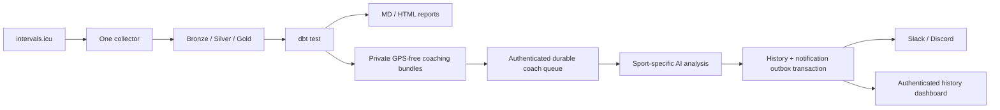

# One project: Training Companion / trisplit

trisplit is the single maintained code source for the Training Companion
project: collection, lakehouse, reports, AI coaching, analysis history and
notifications. The personal `training-companion` workspace remains the current
private source for notes, symptoms, measurements, equipment, clothing, raw
activities and generated results. It is not retired or copied into public Git.

## Layout and ownership

```text
trisplit/                    maintained code, safe to publish after review
  ingest/, transform/, dbt/  canonical collection, deduplication and calculations
  scripts/                  reports and private coach handoff
  airflow/                  scheduling and quality gate
  apps/coach/               analysis, history, dashboard and notification worker
  docs/                     contracts, migration and operations

private training-companion workspace (outside public code)
  activities/, body/, equipment/, wardrobe/
  lakehouse/raw/, lakehouse/warehouse/
  reports/coach-outbox/      private bundles and acknowledgement ledger, NOT web/
  private coach volume      migrated SQLite history and queues
```

The existing lakehouse directory layout stays in place: Iceberg metadata embeds
absolute warehouse paths, so moving it is not required for code consolidation.
The pipeline and coach may remain on different hosts. Deploy the same code
repository on each and run only the relevant component.

## Canonical flow



The coach never fetches intervals.icu. The pipeline's new swim-detail collection
preserves recorded zero-distance rest laps. On the first collection after the
upgrade, existing swims receive their lap detail once; non-swim fingerprints
remain unchanged. Missing Apple Watch rest laps are reconstructed inside the
coach from complete, monotonic streams, using the fingu algorithm. Recorded
source values are not overwritten by inferred rest exclusion.

Bundles are versioned JSON: canonical activity, selected Gold power metrics and
FTP anchor/date, strictly preceding 28-day context, observed stream summaries,
allowlisted swim laps/streams and quality provenance. No GPS coordinates,
descriptions, symptoms, account tokens or raw source JSON are handed to the app
or model. Missing sensor values remain missing; recognized power dropouts and
estimated power suppress power-derived coaching metrics. Rest-included swim
history is labeled and never silently presented as active-swim pace.

`export_coach` and `publish_coach` are separate downstream tasks after
`dbt_test`. Reports do not depend on model calls or Slack. A queue failure fails
its own task and uses the existing Airflow failure alert; retries use the same
activity ID and cannot create another queued analysis. `/api/status` reports
worker failures, unknown messages and backlogs independently of pipeline health.

## Cutover checklist

Current implementation is ready for verification; legacy fingu remains the
live sender until the following operational cutover is performed.

1. Record the current code revisions, DB location, owner, container/volume,
   reverse-proxy targets and disabled/enabled flags. Preserve the original
   fingu repository and Git history. Do not copy its tracked `data/` or
   `node_modules/` into this repository.
2. Build/test `apps/coach`. Migrate an online backup to a private **new** DB;
   verify owner counts, text equality, all activity IDs and processed history.
   Run the new app on a separate private port with analysis/notifications off.
3. Run existing `dbt test`; export to a private outbox and validate real bundles
   with `validateBundle`. Probe ingestion and dashboard access with a temporary
   DB, model/notifications off. Test all three sports synthetically if the recent
   real window lacks a sport. Do not pay for model calls just to test migration.
4. Prepare a single cutover window. Stop the old fingu poller/container, take a
   fresh online backup after it is stopped, and migrate that final copy to the
   new live volume. Reconcile that every legacy processed ID is present. This
   final snapshot is necessary: a prior test backup may miss newly sent swims.
   A SQLite online backup can retain a WAL journal-mode header. Before mounting
   that **backup copy** read-only, open the copy once with write access, set
   `PRAGMA journal_mode=DELETE`, close it and verify `PRAGMA integrity_check`.
   This makes the archive self-contained and avoids `SQLITE_CANTOPEN` when no
   writable directory exists for WAL sidecars. Do not change the live source's
   journal mode. The migration target returns to WAL when the app opens it.
5. Configure `COACH_SINCE` on both components to the chosen local cutover date,
   explicit owner and secrets. Point the existing protected app URL at the new
   port. Enable `COACH_EXPORT_ENABLED` in Airflow, and enable model/notification
   flags in the new app only for the intended live flow. Existing reports and
   their authentication stay in place.
6. Trigger/observe a pipeline with a new activity. Confirm canonical ID, one
   queue entry, one saved analysis, delivery state, channel message and dashboard.
   Confirm re-running the pipeline and night refresh cause no repeat messages.
7. Mark old fingu code **legacy / read-only** and link it to this code source.
   Keep code, DB snapshots and deployment notes for rollback. Old code is not
   an active second collector/sender. The current personal data workspace stays
   active. Older standalone report scripts remain historical only.

Do not archive/delete a live repository or stop the current sender merely
because its replacement compiles. No repository rename or remote archive is
required for this first migration.

### Pipeline settings

Set in the pipeline's private `airflow/.env`, then recreate containers to pass
the new variables through Compose (DAG source changes alone do not update env):

```dotenv
COACH_EXPORT_ENABLED=false
COACH_SINCE=YYYY-MM-DD
COACH_API_URL=https://private-coach-host/api/workouts
COACH_INGEST_TOKEN=YOUR_PRIVATE_TOKEN
```

`COACH_OUTBOX` is configured by Compose under `$TC_ROOT/reports/coach-outbox`.
Set `TC_COACH_URL` to the browser-facing authenticated dashboard URL to add
an “운동 분석” tab to both existing report pages; the app links back through
`COACH_REPORT_URL`. Neither URL should include credentials.
The standalone exporter refuses the code directory and served `reports/web`.
For an explicit offline-quality check, run the exporter only after successful
`dbt test` with `--quality-checked --run-id RUN_ID --since YYYY-MM-DD --out PRIVATE_DIR`.
Exporting never calls the model or Slack; publishing only queues jobs. The
publisher records durable acknowledgements in `published.json`. Expanding a
cutover/backfill window after it has acknowledged `before_cutover` requires
explicit reconciliation of that private ledger and server queue.

## Rollback

Disable pipeline export and stop the new worker before resuming old polling.
Preserve the new DB, analyses and delivery states. Before restarting fingu,
copy back/reconcile **newly completed swimming IDs** into its processed ledger;
otherwise it will analyze/send those swims again. Do not restore a stale DB
blindly. Running/cycling analyses remain in the new DB even if the old swim-only
service is temporarily restored. Unknown notification states need a channel
check before any retry. Keep both original Git history and final DB backups.
